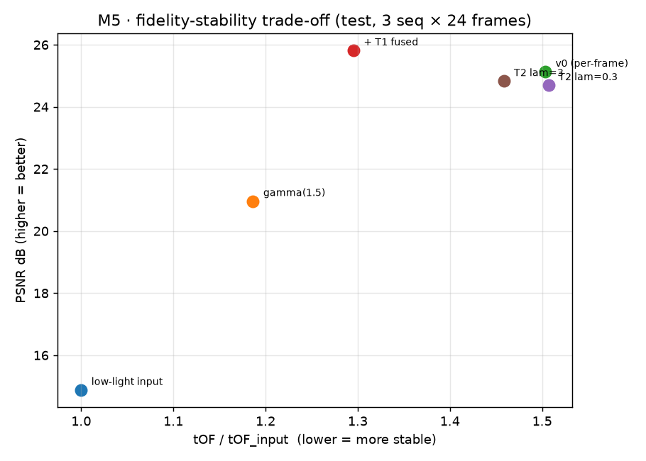

# 低光视频增强 + 时序一致性（Low-Light Video Enhancement with Temporal Consistency）

  

单帧低光增强器用在视频上会**闪烁**（flickering）。本项目从一个逐帧 U-Net 基线出发，
依次加入**光流 warp 融合**（T1）、**训练期 warp 一致性损失**（T2）、**循环传播**（T3），
把「保真度（PSNR）」和「时序稳定性（tOF）」的 trade-off 完整量化出来。

这不是一个"刷分"项目，而是一组**受控实验**：每个阶段先写验收标准，跑完数字再对照，
不达标就停下来修，负结果也如实入册。

## 核心结论（全部数字可复现）

| 方法 | PSNR↑ | SSIM↑ | tOF↓ | tOF/tOF_in↓ | 说明 |
|---|---|---|---|---|---|
| 低光输入 | 14.88 | 0.615 | 18.55 | 1.000 | EV=2.5 物理合成低光 |
| gamma(1.5) | 20.96 | 0.646 | 21.66 | 1.186 | 变亮 ≠ 变好，噪声被同步放大 |
| CLAHE | 19.82 | 0.551 | 31.38 | 1.685 | 局部增益逐帧独立 → 闪烁 +65% |
| **逐帧 U-Net（B1）** | **24.83** | **0.833** | 28.20 | 1.458 | 保真度大幅领先，**但闪烁仍被放大** |
| B1 + T1 warp 融合 | 25.32 | 0.855 | 24.95 | **1.271** | 训练无关后处理，tOF −12.3% |
| B1 + T2 warp 损失(λ=3) | 24.83 | 0.833 | 28.20 | 1.458 | 时序约束被主损失淹没（诊断见下） |
| B1 + T2 + T1 | 25.32 | 0.855 | 24.95 | 1.271 | 当前最优组合 |
| B1 + T3 循环传播 | 24.29 | 0.797 | 28.49 | 1.479 | 循环收益仅 ~2%，负结果 |

**三条路线（T1/T2/T3）汇出的同一个发现**：tOF 的残差大头是**内容相关**的模型误差
（同一场景、同样的错误，光流对齐消不掉），不是噪声抖动。时序一致性的收益边界
由模型本身的逐帧误差决定 —— 这比"我们又提了一个模块"更有信息量。

最核心的一张图（保真度–稳定性 trade-off，`reports/m5_scatter.png`）：



## 这个项目如何防止自己骗自己

七条硬规则全部落实：

1. **序列级划分**（train 8 / val 2 / test 3），脚本自检无重叠 —— 帧级随机划分是本领域常见的隐性泄漏
2. **参数只在 val 上选**（B0 网格搜索、T1 扫 48 组），test 一次性使用
3. **测试噪声固定 seed**，训练噪声每 epoch 在线重采样 —— 两种口径在报告里写明
4. **置换对照**：把 T1 的光流随机打乱，融合必须失效或变差（shuffled tOF 32.08 vs 正常 24.95 ✅）
5. **tOF 的光流固定在 GT 帧上估计** —— 防止"把画面糊掉骗取低 tOF"的指标作弊
6. **验收线先于实验写下**，不达标不进下一阶段（M3 的错误报告曾因此被拦下重做）
7. **负结果入册**：T2 第一轮 λ=0.3 无效（梯度占比仅 1.3%）、T3 两条证据链完整 —— 过程见 `reports/m4_*.md`

### 教学价值：真实踩过的坑（全部记录在案）

- **双零初始化陷阱**：residual 头和 gain 头同时零初始化 → 主干梯度恒 0，网络学不到
- **AMP 下 SSIM 梯度 NaN**：autocast 是 thread-local，内部 `.float()` 也拦不住 conv 转 fp16
- **中文路径**：`cv2.imread/imwrite` 在 Windows 中文路径下静默失败，必须 `np.fromfile + imdecode`
- **sRGB 转换性能**：`np.power` 逐元素 ~20ms/帧，uint8 查表 1.6ms，无损

## 快速开始

```bash
git clone https://github.com/wanzi-qz/wanzi-lowlight-video.git
cd wanzi-lowlight-video

python -m venv .venv && .venv\Scripts\activate        # Linux/macOS: source .venv/bin/activate
pip install -r requirements.txt
python scripts/00_check_env.py                        # 环境自检 → reports/env_report.md
```

数据（DAVIS-2017 480p，约 800MB，断点续传）与完整复现：

```bash
python scripts/download_davis.py
python scripts/run_all_reproduce.py                   # 一键复现全部表格与图
```

单阶段复现（每个报告对应一条命令）：

| 报告 | 命令 |
|---|---|
| M1 合成管线验收 | `python scripts/10_verify_synthesis.py` |
| M2 经典 baseline | `python scripts/20_eval_classical.py --max-frames 8` |
| M3 训练 U-Net | `python scripts/30_train_unet.py --iters 4000` |
| M3 评估 | `python scripts/31_eval_unet.py --ckpt runs/unet_v0/best.pt` |
| M4 T1 评估 | `python scripts/40_eval_t1.py` |
| M5 汇总分析 | `python scripts/50_m5_analysis.py` |

冒烟测试（CPU 约 2 分钟，验证全链路无断点）：

```bash
python tests/test_smoke.py
```

## 项目结构

```
LowLightVideo/
├── ROADMAP.md          # 路线图：六阶段、每阶段验收标准、风险预案
├── DECISIONS.md        # 决策记录（D1–D5，含技术依据）
├── docs/PROJECT_REPORT.md   # 面向"第一次看的人"的完整项目说明
├── src/
│   ├── synthesis.py    # 物理低光合成（sRGB→线性→Poisson→读出噪声→JPEG）
│   ├── metrics.py      # 全项目唯一指标实现（PSNR/SSIM/LPIPS/tOF）
│   ├── data.py         # 序列级划分 + 运动速度分层
│   ├── train_utils.py  # 在线合成噪声数据集、L1+SSIM 损失
│   ├── models/unet.py  # 1.95M U-Net（gain/residual 双头）
│   ├── models/unet_gru.py  # T3 循环变体（瓶颈 ConvGRU）
│   ├── temporal/       # T1 warp 融合（遮挡掩码 + 置信度加权）
│   └── baselines/classical.py  # gamma / CLAHE / SSR
├── scripts/            # 每个报告 = 一条命令（00–50 编号即执行顺序）
├── configs/            # YAML 配置（相机参数、扫参网格）
├── reports/            # 全部验收报告（md/csv/json 入库，大图不入库）
├── tests/test_smoke.py # CPU 冒烟测试（~2 分钟）
└── runs/               # 训练输出（不入库）
```

## 主要局限（如实写）

- **合成噪声 ≠ 真实噪声**：管线牺牲分布真实性换可证伪实验设计，未在真实低光数据上验证
- **tOF 依赖光流质量**：Farneback 在快速运动上精度有限（oracle 实验显示光流不是当前瓶颈）
- **未含 ISP 因素**：FPCC、时域降噪等真实相机处理链不在模型内，结论外推有限
- T1 的 Farneback 光流在 CPU 上约 1.4s/帧，工程部署需换 RAFT-TensorRT

## 引用 / 参考

- DAVIS 2017 — Perazzi et al., *A Benchmark Dataset and Evaluation Methodology for Video Object Segmentation*, CVPR 2016
- SDSD — Chen et al., *Seeing Dynamic Scene in the Dark*, ICCV 2021
- Zero-DCE — Guo et al., CVPR 2020
- Learning Temporal Consistency for LLVE — Chu et al., CVPR 2021（T2 的思路来源）
- BasicVSR — Chan et al., CVPR 2021（T3 的思路来源）
